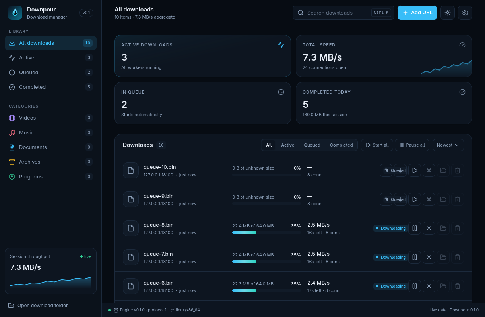

# Downpour

**A cross-platform, multi-connection download manager for Windows, macOS, and Linux.**

[](https://github.com/yash244466666/downpour/actions/workflows/ci.yml)



<sub>M4 dashboard — live queue with concurrency limits and priorities.</sub>

Downpour brings IDM-class downloading — segmented transfers, crash-safe resume,
queues, browser take-over, and media grabbing — to all three desktop platforms
with an open-source implementation and a modern interface.

> **Status: M6 (media).** Downloads work end to end — probe, 1–32 parallel
> connections, crash-safe resume, throttling, SHA-256 — with a live dashboard,
> queue/scheduler, browser take-over, and media handling: HLS URLs use yt-dlp
> when installed or a built-in HLS fallback, and the extension sniffs
> `.m3u8`/`.mpd` manifests. The site grabber is **not implemented yet**. See
> the [roadmap](docs/roadmap.md).

## Why Downpour

Download managers with segmented transfers and browser integration are
traditionally Windows-only, closed-source, and visually dated. Downpour is:

- **Cross-platform** — Windows, macOS, and Linux from one Rust codebase.
- **Fast where it matters** — Rust/tokio engine, one writer thread per download,
  positional I/O, crash-safe checkpoints.
- **Open source** — MIT OR Apache-2.0, with no telemetry.
- **Modern** — Tauri 2 + React dashboard, dark/light themes, keyboard-first.
- **Honest about limits** — no DRM circumvention, no bundling ffmpeg.

## Features

### Working today (M4)

- **Persistent queue** with concurrency and per-host limits, priorities,
  Start all / Pause all, and automatic scheduling within a start/stop window.
- **Media handling**: HLS manifests download with the built-in fallback
  (quality = highest variant, AES-128 supported, SAMPLE-AES refused); yt-dlp is
  detected and used when available, with cookies passed via a 0600 file.
- **Browser take-over (Chromium/Edge)**: the extension hands downloads,
  cookies, referer, and user agent to the engine via the native-messaging host,
  and remembers manifest URLs for a "Download media" menu.
- **Local IPC** over a Unix socket / Windows named pipe with a per-start token.
- **Live desktop dashboard** wired to the engine: add, pause, resume, cancel,
  remove, reveal in folder, category filters, and persistent settings.
- Tray icon, close-to-tray, completion notifications, autostart, and
  single-instance behavior.
- **Real downloads over 1–32 connections** with probe-based size/range/ETag
  detection, `.downpour-part` temp files, and atomic rename.
- **Dynamic segmentation**: segments are finer than workers, so a fast worker
  pulls the next range instead of idling.
- **Byte-rate throttling** (global and per-download) with a token bucket.
- **Crash-safe resume**: durable checkpoints after `fsync`, restart recovery,
  validator comparison, and restart-from-zero when content changed.
- **Pause/resume/cancel** from the CLI; SIGINT pauses safely.
- **SHA-256** recorded for every completed download and verified when a
  checksum is supplied.
- Rust workspace with shared DTOs, SQLite schema/migrations, segment planner,
  filename sanitizer, IPC framing, and a fault-injecting test server.
- Tauri 2 desktop shell with a React 19 dashboard; the browser-only preview
  keeps clearly labelled mock data.
- Dark/light themes, filters, search, add-URL dialog, engine-info bridge.
- CI for Linux, Windows, and macOS.

### Planned for v1

- Queue-level concurrency, scheduler, and categories.
- Browser take-over, media grabbing, and the site grabber.
- Queue with global/per-host limits, priorities, categories, scheduler.
- Global and per-download bandwidth throttling.
- Chromium + Firefox extension: download take-over, context menu, media
  sniffing, cookie/UA/referer handoff.
- HLS/DASH detection, quality selection, optional yt-dlp integration.
- Site grabber with robots.txt, rate limits, depth/page caps.
- Batch URL import with `img[001-100].jpg`-style expansion.
- Tray residency, notifications, autostart, signed auto-updates.
- Installers: NSIS (Windows), DMG (macOS), AppImage/deb/rpm (Linux).

### Explicit non-goals for v1

Separate daemon, Safari extension, BitTorrent, cloud sync, mobile apps, an
in-app browser, native DASH muxing, and Flatpak/Snap native messaging.

## Architecture

```
┌──────────────────────────────┐          ┌──────────────────────────────────┐
│ Browser extension (MV3)      │          │ Downpour desktop (Tauri 2)       │
│ Chromium / Firefox           │          │  React dashboard (webview)       │
│ · media sniffing             │          │  Tauri commands ↑ / events ↓     │
│ · download take-over         │          │  ┌────────────────────────────┐  │
└──────────────┬───────────────┘          │  │ downpour-core engine       │  │
               │ native messaging         │  │ tokio · reqwest · planner  │  │
┌──────────────▼───────────────┐          │  └───────────┬────────────────┘  │
│ downpour-nm-host             │          │              │                   │
└──────────────┬───────────────┘  local   │  SQLite (rusqlite)   .part files │
               └──── JSON-line IPC ──────►│                                  │
                 (UDS / named pipe)       └──────────────────────────────────┘
```

The engine is an independent crate with no Tauri dependency, so it can become a
standalone daemon later. A single tray-resident process hosts it in v1.

| Crate | Responsibility |
|---|---|
| `downpour-types` | Serde DTOs, error codes, protocol version |
| `downpour-store` | SQLite schema, migrations, queries |
| `downpour-core` | Probe, planner, transfer, checkpoints, throttling |
| `downpour-ipc` | JSON-line protocol, framing, handshake |
| `downpour-media` | yt-dlp management, HLS parsing, tool detection |
| `downpour-grabber` | Crawling, link extraction, batch expansion |
| `downpour-nm-host` | Browser native-messaging host |
| `downpour-testkit` | Fault-injecting HTTP server (dev only) |
| `apps/desktop` | Tauri 2 shell + React dashboard |
| `apps/cli` | `downpour` CLI and integration harness |

Read [docs/architecture.md](docs/architecture.md) for the transfer pipeline,
crash-safety rules, IPC security, and platform notes.

## Tech stack

| Layer | Choice |
|---|---|
| Engine | Rust 2024, tokio 1.54, reqwest 0.13 (rustls) |
| Persistence | SQLite via rusqlite 0.40 (`bundled`), WAL, STRICT tables |
| Desktop | Tauri 2.11, WebView2/WKWebView/WebKitGTK |
| UI | React 19, TypeScript 7, Vite 8, Tailwind CSS 4, lucide-react |
| Browser | WXT (planned), MV3 Chromium + Firefox |
| Media | yt-dlp (optional, checksum-verified), ffmpeg (detected only) |

## Getting started

### Prerequisites

- Rust stable **1.85+** (edition 2024).
- Node **20+**, pnpm **10** (`corepack enable` is easiest).
- Platform dependencies for Tauri:

**Linux (Arch/Manjaro)**
```bash
sudo pacman -S --needed webkit2gtk-4.1 gtk3 libayatana-appindicator \
  librsvg xdotool patchelf
```

**Linux (Debian/Ubuntu)**
```bash
sudo apt install libwebkit2gtk-4.1-dev libgtk-3-dev \
  libayatana-appindicator3-dev librsvg2-dev libxdo-dev patchelf
```

**macOS** — `xcode-select --install` (WebKit is part of the OS).

**Windows** — Visual Studio Build Tools (MSVC) and WebView2 (preinstalled on
Windows 10/11).

### Run it

```bash
git clone git@github.com:yash244466666/downpour.git
cd downpour
git switch dev

pnpm install
cargo test --workspace

# Real desktop window
pnpm tauri dev

# Browser-only UI preview (mock data)
pnpm --dir apps/desktop dev
```

The first Tauri build takes several minutes (debuginfo linking); later runs are
seconds.

### Browser take-over

```bash
cargo build -p downpour-nm-host -p downpour-cli
./target/debug/downpour register-browsers
```

Then load `extensions/browser/chromium` unpacked in Chrome/Edge and start
Downpour once. See [extensions/browser/README.md](extensions/browser/README.md).

### Download something from the CLI

```bash
cargo build -p downpour-cli
./target/debug/downpour add https://example.com/big.zip
./target/debug/downpour run          # Ctrl-C pauses; rerun to resume
./target/debug/downpour list
./target/debug/downpour info <id>
./target/debug/downpour cancel <id>  # only when no process is downloading it
```

`--db <path>` and `--dir <path>` (or `DOWNPOUR_DB` / `DOWNPOUR_DIR`) override
the per-user database and download directory. `downpour get <url>` adds and
starts in one step. The engine runs in-process in M1; the shared daemon and IPC
commands come with M5.

### Build installers

```bash
pnpm tauri build
```

Bundling currently produces unsigned artifacts. Signing and notarization are
wired in M8 and require Apple Developer / Windows signing credentials.

## Project layout

```
downpour/
├─ crates/                  Rust workspace members
│  ├─ downpour-types/       DTOs, errors, protocol version
│  ├─ downpour-store/       SQLite schema + migrations
│  ├─ downpour-core/        engine (planner, filename, transfer)
│  ├─ downpour-ipc/         local protocol + framing
│  ├─ downpour-media/       media classification, tool detection
│  ├─ downpour-grabber/     batch expansion, crawler (planned)
│  ├─ downpour-nm-host/     browser native-messaging binary
│  └─ downpour-testkit/     fault-injecting test server
├─ apps/
│  ├─ cli/                  `downpour` CLI
│  └─ desktop/              Tauri 2 app + React dashboard
├─ extensions/browser/      WXT extension (M5)
├─ docs/                    architecture, protocol, ADRs, roadmap
├─ .github/workflows/       CI (3 OS + frontend)
├─ CLAUDE.md                project context for Claude Code
└─ AGENT.md                 working agreement for coding agents
```

## Testing and quality gates

```bash
cargo fmt --all --check
cargo clippy --workspace --all-targets -- -D warnings
cargo test --workspace
pnpm --dir apps/desktop typecheck
pnpm --dir apps/desktop test
pnpm --dir apps/desktop build
```

Engine tests run against `downpour-testkit`, a local fault-injecting HTTP server
with deterministic byte patterns — no public-internet tests. Crash tests kill a
CLI process at random offsets and compare SHA-256 against the source once the
engine lands.

Current state: **110 Rust tests and 20 frontend unit tests pass**, clippy is
warning-free, and the frontend typechecks and builds. Engine tests cover byte-exact transfers, segmented
concurrency, throttling, pause/resume, engine restarts, a real SIGKILL resume,
ETag/content changes, `429`, dropped connections, permanent truncation,
redirects, auth failures, and traversal filenames.

## Branching and releases

- **`dev` is the default branch.** Feature branches (`feat/…`, `fix/…`) branch
  from it and open PRs back into it.
- **`main` is release-only and pulls from `dev`.** Local `main` is configured to
  track `origin/dev`, so `git pull` on `main` brings the latest integration
  state. Releases are tagged on `main`.
- CI must be green before a PR merges.
- Never force-push `dev` or `main`.

## Roadmap

| # | Milestone | State |
|---|---|---|
| M0 | Workspace, schema, planner, filename safety, IPC types, testkit, dashboard, CI, docs | ✅ |
| M1 | Probe, single-stream transfer, SQLite journal/resume, pause, CLI | ✅ |
| M2 | Multi-connection, dynamic segmentation, throttling, retries, crash tests | ✅ |
| M3 | Full UI wired to engine, tray, notifications, settings | ✅ |
| M4 | Queue, scheduler, categories, autostart, single-instance | ✅ |
| M5 | IPC server/client, native host, Chromium/Edge extension | ✅ |
| M6 | yt-dlp, media detection, HLS fallback | ✅ |
| M7 | Site grabber, batch import | next |
| M8 | Packaging, signing, notarization, release CI | |
| M9 | Accessibility, i18n, diagnostics, docs | |

Detailed acceptance criteria live in [docs/roadmap.md](docs/roadmap.md).

## Security and legal

- No DRM circumvention, no paywall bypass, no authorization to download content
  you have no right to. Respect site terms and copyright law.
- The site grabber honors `robots.txt` and rate-limits by default.
- No telemetry by default; data stays local.
- yt-dlp (Unlicense) is optional and checksum-verified. ffmpeg is **never**
  bundled; it is detected as an external dependency under its own license.

## Contributing

Read [CLAUDE.md](CLAUDE.md) for project invariants and [AGENT.md](AGENT.md) for
the working agreement, gates, and definition of done. Keep pull requests focused,
add tests for behavior changes, and keep the docs current.

## License

Licensed under either of

- Apache License, Version 2.0 ([LICENSE-APACHE](LICENSE-APACHE))
- MIT License ([LICENSE-MIT](LICENSE-MIT))

at your option.
